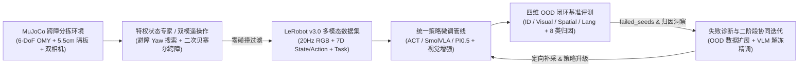
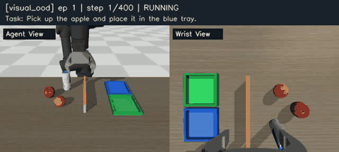
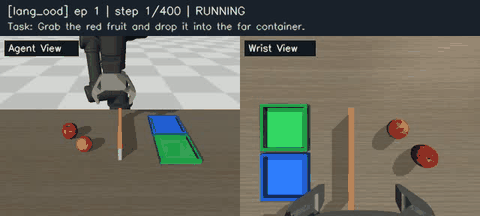
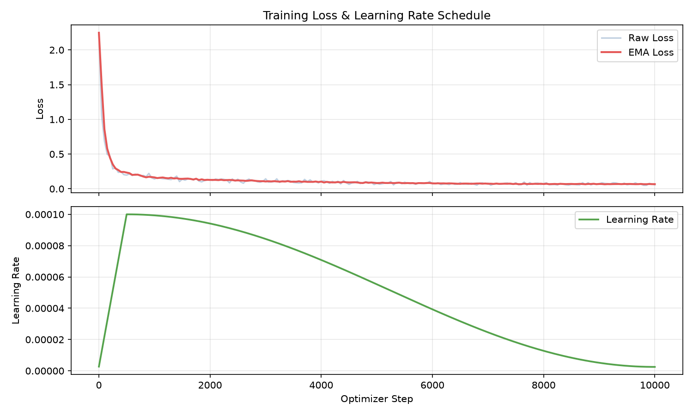

# Language-Conditioned 3D Obstacle-Crossing Manipulation & OOD VLA Benchmark

基于 **MuJoCo** 与 **LeRobot v3.0** 构建的**语言条件跨障桌面分拣仿真平台、自动化数据生成飞轮与多策略 VLA（Vision-Language-Action）泛化评测基准**。

本项目面向机器人具身智能操作场景，针对桌面多物体跨障分拣任务（Pick-and-Place over a 5.5 cm Barrier），完整打通了 **高拟真物理场景建模 → 特权状态 IK/贝塞尔专家自动采数 → 低显存策略微调（ACT / SmolVLA / PI0.5）→ 四维 OOD 闭环基准与 8 类失败归因 → 两阶段迭代调优与推理加速消融** 的工程与算法闭环。

---

## 核心亮点

1. **语言条件 3D 跨障分拣环境（[y_env.py](mujoco_env/y_env.py)、[sorting_objects.xml](asset/sorting_objects.xml)）**
   - 在 `ROBOTIS OpenManipulator-Y` 6 轴机械臂平台上构建双区桌面环境（左侧随机布局苹果/橙子 + 可选高 11.5 cm 红牛罐干扰物；中间 5.5 cm 半透明隔板强制策略学习 3D 抬升越障弧线；右侧蓝/绿双色分拣托盘），支持 4 条标准语言指令及未见同义改写指令解析。
   - 使用 RK4 + 20 步 `noslip` 接触求解与 1:1 平行指尖联动防挤飞设计，兼顾双目固定相机（`agentview` + `egocentric` 腕部视角）、键盘/游戏手柄双模遥操作与无界面离屏高速渲染。
2. **零碰撞特权专家与自动化数据管线（[expert.py](mujoco_env/expert.py)、[auto_collect.py](scripts/auto_collect.py)）**
   - 结合几何避障抓取偏航角搜索、余弦加减速插值与二次贝塞尔越障轨迹规划，在 80 回合全维度评测中达成 **100.0% (80/80) 成功率与 0.0% 隔板碰撞率**。
   - 支持 `--task-mode cycle` 严格四任务均衡、隔板碰撞自动拒收、`--seeds-file` 困难样本回流续录，以及 [visualizeData.py](scripts/visualizeData.py) 无界面物理复现一致性检验。
3. **消费级低显存多策略微调管线（[train_act.py](scripts/train_act.py)、[train_smolvla.py](scripts/train_smolvla.py)、[train_pi05.py](scripts/train_pi05.py)）**
   - 统一接入 [train_utils.py](scripts/train_utils.py)：按 Episode 维度无泄露划分验证集、`bf16`/`fp16` 混合精度 + 梯度累积（仅 **6.1~6.7 GB 显存** 即可微调 450M 参数 SmolVLA）、Warmup + Cosine 调度、`best_ema` 落盘，以及支持 3D/4D/5D 时序张量的向量化视觉增强（颜色抖动、高斯噪声、随机遮挡）。
4. **四维 OOD 闭环评测与细粒度失败归因（[eval_benchmark.py](scripts/eval_benchmark.py)）**
   - 统一同种子评测 `id`、`visual_ood`（红牛罐干扰）、`spatial_ood`（边界外推）、`lang_ood`（未见同义改写指令）四个套件，追踪 **Reach → Grasp → Cross → Success** 阶段转化率、P95 延迟与 8 类失败归因，并支持动作块缓存命中步跳过冗余离屏渲染（评测提速 3~5 倍）。

---

## 系统架构与数据闭环



---

## 闭环演示效果（Agent View + Wrist View）

> 所有演示视频均由 [eval_benchmark.py](scripts/eval_benchmark.py) 在相同随机种子 `seed=100` 下无界面闭环录制导出。

| `ID` 标准场景 (`SmolVLA v3`, 172 steps) | `Visual OOD` 红牛罐干扰 (`SmolVLA v3`, 167 steps) |
| :---: | :---: |
|  |  |
| **`Spatial OOD` 位置外推 (`SmolVLA v3`, 158 steps)** | **`Lang OOD` 同义指令上限 (`Expert Oracle`, 151 steps)** |
|  |  |

---

## 实验评测与深度归因分析

### 1. 四维闭环基准横向对比（80 回合 / 模型，固定种子 `100~119`）

在每个套件各 20 回合（四任务循环均衡、共计 80 回合 / 模型）上的实测闭环结果如下：

| 模型 / 配置 | `ID` 成功率 | `Visual OOD` | `Spatial OOD` | `Lang OOD` | **总成功率 (ALL)** | 全局 Reach / Grasp | 隔板碰撞率 | Avg ms (FPS) | 完整报告 |
| :--- | ---: | ---: | ---: | ---: | ---: | ---: | ---: | ---: | :--- |
| **Privileged Expert (Oracle)** | 100.0% (20/20) | 100.0% (20/20) | 100.0% (20/20) | 100.0% (20/20) | **100.0% (80/80)** | 100.0% / 100.0% | 0.0% | 0.91 ms (1098.6) | [report](benchmarks/expert_oracle/report.md) |
| **ACT (Multi-Task, chunk=20)** | 0.0% (0/20) | 0.0% (0/20) | 0.0% (0/20) | 0.0% (0/20) | **0.0% (0/80)** | 46.2% / 42.5% | 80.0% | 1.44 ms (692.5) | [report](benchmarks/act_baseline/report.md) |
| **SmolVLA v1** (`chunk=5, ID-Only, Expert-Only`) | 5.0% (1/20) | 10.0% (2/20) | 15.0% (3/20) | **10.0% (2/20)** | **10.0% (8/80)** | 38.8% / 31.2% | 36.2% | 46.29 ms (21.6) | [report](benchmarks/smolvla_baseline/report.md) |
| **SmolVLA v2** (`chunk=30, +OOD Data & Aug, Expert-Only`) | 30.0% (6/20) | 5.0% (1/20) | **20.0% (4/20)** | 0.0% (0/20) | **13.8% (11/80)** | 57.5% / 38.8% | **13.8%** | 15.62 ms (64.0) | [report](benchmarks/smolvla_v2/report.md) |
| **SmolVLA v3** (`Stage-2 VLM+Expert Co-Finetune, Clean Wrist`) | **45.0% (9/20)** | **40.0% (8/20)** | **20.0% (4/20)** | 0.0% (0/20) | **26.2% (21/80)** | **75.0% / 58.8%** | 18.8% | **13.50 ms (74.1)** | [report](benchmarks/smolvla_v3/report.md) |
| **SmolVLA v3 (3-Step Denoise, ID Pareto 最优)** | **50.0% (10/20)** | — | — | — | — | **85.0% / 60.0%** | **5.0%** | **5.51 ms (181.5)** | [report](benchmarks/ablation_denoising/report.md) |

### 2. 失败归因演化与关键算法洞察

下表统计各模型在全量 80 回合中的失败分布（不含成功回合）：

| 模型 | 失败总数 | `wrong_object` | `distractor_hijack` | `wrong_tray` | `release_or_retreat_fail` | `barrier_drop` | `transit_drop` | `grasp_fail` | `reach_timeout` |
| :--- | ---: | ---: | ---: | ---: | ---: | ---: | ---: | ---: | ---: |
| `ACT (Multi-Task)` | 80 | 28 | 2 | 0 | 1 | 26 | 5 | 3 | 15 |
| `SmolVLA v1` | 72 | 19 | 1 | 1 | 0 | 13 | 3 | 8 | 27 |
| `SmolVLA v2` | 69 | 13 | **0** | 2 | 0 | **4** | 12 | 16 | 22 |
| `SmolVLA v3` | **59** | **11** | **0** | 2 | 0 | 9 | 15 | 15 | **7** |

1. **无语言 ACT 在多任务混训中的多模态均值崩溃**：`ACT` 虽以 `1.44 ms (692.5 FPS)` 的极高吞吐学会了 `id` 阶段 `70.0%` 的抓起动作基元，但因缺乏语言条件编码器，面对同桌面 4 种目标组合时陷入模态混淆（`wrong_object=28`、`barrier_drop=26`），端到端成功率为 `0.0%`。
2. **开环低 MAE 与闭环本体状态捷径（`SmolVLA v1`）**：`SmolVLA v1`（`chunk_size=5`）在留出验证集上的离线开环 MAE 低至 `0.0201 rad`，但闭环仅达 `10.0%`。短动作块导致模型通过本体关节状态惯性外推即可获得低训练损失，在初始位置与跨障阶段缺乏长时域轨迹约束（`reach_timeout=27`, `barrier_drop=13`）。
3. **长时域动作块与数据扩展（`SmolVLA v2`）**：将 `chunk_size` 扩至 `30`（`n_action_steps=15`）并从 200 条常规轨迹扩展至 264 条（追加 64 条含 50% 干扰物/空间外推的均衡轨迹）后，`id` 成功率提升 6 倍（`5.0% -> 30.0%`），隔板碰撞率骤降（`36.2% -> 13.8%`），`distractor_hijack` 降至 `0`。同时定位到新瓶颈：对腕部相机叠加 `--aug-wrist` 强增强破坏了近距亚厘米夹持对齐（`grasp_fail=16, transit_drop=12`）。
4. **二阶段 VLM+专家协同精调与语言遗忘权衡（`SmolVLA v3`）**：在 `v2` 基础上关闭腕部擦除/强增强、解冻 16 层多模态 VLM 主干（可训练参数 `306.47M/450.05M`，峰值显存 `6.12 GB`）联合精调 6,000 步后，`id` 成功率跃升至 **`45.0%`**、`visual_ood` 跃升 **8 倍至 `40.0%`**（`Grasp 70.0%`, `distractor_hijack=0`）、全局 `Reach` 达 `75.0%`、`reach_timeout` 从 `27` 降至 `7`。同时也定量观察到在仅含 4 条固定模板句的数据集上解冻 VLM 会引发 `lang_ood` 零样本改写指令退化（`0.0%`），为后续引入同义指令改写增强提供了明确优化方向。

### 3. 消融实验

#### (1) Receding-Horizon 闭环重规划周期消融（`SmolVLA v2`, `id` 20 回合）

| `n_action_steps` | 重规划周期 | Success | Reach | Grasp | Cross | Barrier Hit | Avg ms (FPS) | 核心权衡 |
| ---: | ---: | ---: | ---: | ---: | ---: | ---: | ---: | :--- |
| `15` (default) | 0.75 s | **35.0% (7/20)** | **80.0%** | **60.0%** | **40.0%** | **5.0%** | **12.95 (77.2)** | 越障弧线最连贯，隔板碰撞最低 |
| `8` | 0.40 s | 20.0% (4/20) | 55.0% | 50.0% | 25.0% | 40.0% | 23.68 (42.2) | 半途重采样引发轨迹切换撞板 |
| `5` | 0.25 s | **35.0% (7/20)** | 65.0% | **60.0%** | 35.0% | 30.0% | 38.98 (25.7) | `grasp_fail` 降至 1，但 `wrong_object` 翻倍至 6 |

详见：[benchmarks/ablation_replanning/report.md](benchmarks/ablation_replanning/report.md)

#### (2) Flow Matching 去噪步数 Pareto 权衡消融（`SmolVLA v3`, `id` 20 回合）

| `num_denoising_steps` | Success | Reach | Grasp | Barrier Hit | Avg Steps | Avg ms | P95 ms | FPS |
| ---: | ---: | ---: | ---: | ---: | ---: | ---: | ---: | ---: |
| `10` (default) | 45.0% (9/20) | **85.0%** | 60.0% | 30.0% | 293.1 | 13.74 | 192.17 | 72.8 |
| `5` | 20.0% (4/20) | 75.0% | 50.0% | 15.0% | 352.6 | 7.61 | 108.36 | 131.5 |
| **`3` (Pareto 最优)** | **50.0% (10/20)** | **85.0%** | 60.0% | **5.0%** | **281.7** | 5.51 | 78.19 | **181.5** |
| `1` | 35.0% (7/20) | 80.0% | **70.0%** | 25.0% | 314.6 | **3.33** | **46.59** | **300.4** |

> 将 Flow Matching 欧拉去噪从 `10` 步降至 `3` 步，推理延迟直降 **2.49×**（`13.74 ms -> 5.51 ms`, `181.5 FPS`），同时 `id` 成功率提升至 **50.0% (10/20)**、隔板碰撞降至 **5.0%**。详见：[benchmarks/ablation_denoising/report.md](benchmarks/ablation_denoising/report.md)。

### 4. 训练收敛与验证集开环评估曲线

| `SmolVLA v2` 训练收敛 (`loss -> 0.0671`) | `SmolVLA v3` 协同精调收敛 (`loss -> 0.0581~0.0627`) | `SmolVLA v3` 留出验证集开环 MAE (`ep260: 0.0191`) |
| :---: | :---: | :---: |
|  |  |  |

---

## 项目结构

```text
vla-mujoco-tutorial/
├── asset/                        # MuJoCo 场景、ROBOTIS OMY 机械臂与 YCB 物体模型
│   ├── example_scene_y.xml       # 主场景入口 XML
│   ├── sorting_objects.xml       # 中间 5.5cm 隔板、蓝/绿托盘与动态物体定义
│   ├── robotis_omy/              # OpenManipulator-Y 机械臂与平行夹爪
│   └── tabletop/                 # 桌面、三路固定相机与物体网格纹理
├── mujoco_env/                   # 仿真环境与特权专家模块
│   ├── y_env.py                  # SimpleEnv 多任务环境、双模遥操作、碰撞/诊断接口
│   ├── expert.py                 # PrivilegedSortingExpert（避障偏航搜索 + 贝塞尔跨障）
│   ├── mujoco_parser.py          # MuJoCo 底层状态/雅可比/渲染封装
│   ├── ik.py                     # 阻尼最小二乘逆运动学求解器
│   ├── transforms.py / utils.py  # 姿态变换与几何采样工具
├── scripts/                      # 统一 CLI 数据/训练/评测/部署管线
│   ├── auto_collect.py           # 自动化轨迹生成与断点续录（支持 --seeds-file 回流）
│   ├── collectData.py            # 键盘 + 手柄双模遥操作数据采集
│   ├── visualizeData.py          # GUI 轨迹回放与无界面物理复现质检
│   ├── train_act.py              # ACT 策略训练脚本
│   ├── train_smolvla.py          # SmolVLA 策略训练与消融脚本
│   ├── train_pi05.py             # PI0.5 策略训练脚本
│   ├── train_utils.py            # 无泄露切分、3D/4D/5D 视觉增强、Warmup+Cosine、日志绘图
│   ├── eval_benchmark.py         # 四维 OOD 闭环基准评测、8 类失败归因与双视角视频导出
│   └── deploy.py                 # 统一多模型交互式部署与自定义指令测试
├── benchmarks/                   # 归档实验报告与消融汇总
├── media/                        # 轻量化演示 GIF 与训练曲线图
├── tests/                        # 自动化环境与专家烟雾测试
├── pyproject.toml                # 包配置与 CLI 入口注册
└── requirements.txt              # 核心运行依赖
```

---

## 快速复现指南

### 1. 环境安装与烟雾测试

建议使用 Python 3.10+（已验证 Python 3.12 + PyTorch CUDA + LeRobot 0.7.0 + MuJoCo 4.0.1）：

```bash
pip install -r requirements.txt
pip install --no-deps -e .

# 运行离线无界面烟雾测试（校验 OOD 重置、同义指令解析与特权专家零碰撞越障）
python -m unittest discover -s tests -v
```

### 2. 数据采集与回放质检

```bash
# 自动化生成 200 条均衡轨迹（或使用 --resume-dir 追加 OOD 轨迹）
python -m scripts.auto_collect --num-episodes 200 --task-mode cycle --output-dir ./dataset/smolvla_dataset --seed 42

# 人工键盘 + 手柄遥操作采集（WASD/RF 平移，QE/方向键旋转，Space 开合，Z 重置）
python -m scripts.collectData --num-episodes 20 --task-mode cycle

# 无界面物理复现一致性质检（可选 --save-video-dir 导出双视角视频）
python -m scripts.visualizeData --dataset-root ./dataset/smolvla_dataset --repo-id omy_sorting_vla --episode 0 --headless
```

### 3. 策略训练（ACT / SmolVLA / PI0.5）

```bash
# 1) 训练 ACT 多任务对照基线
python -m scripts.train_act \
  --repo-id omy_sorting_vla --dataset-root ./dataset/smolvla_dataset --output-dir ./ckpt/act_baseline \
  --chunk-size 20 --n-action-steps 10 --steps 10000 --batch-size 64 --amp --num-workers 4

# 2) Stage-1 训练 SmolVLA（长时域 + 视觉增强 + 仅训动作专家，约 6.7 GB 显存）
python -m scripts.train_smolvla \
  --pretrained-path lerobot/smolvla_base --repo-id omy_sorting_vla --dataset-root ./dataset/smolvla_dataset_v2 \
  --output-dir ./ckpt/smolvla_v2 --chunk-size 30 --n-action-steps 15 --steps 10000 --batch-size 32 \
  --amp --amp-dtype bf16 --freeze-vision-encoder --train-expert-only --image-aug --aug-wrist

# 3) Stage-2 协同精调 SmolVLA（解冻 VLM 主干 + 洁净腕部视角，约 6.1 GB 显存）
python -m scripts.train_smolvla \
  --pretrained-path ./ckpt/smolvla_v2 --repo-id omy_sorting_vla --dataset-root ./dataset/smolvla_dataset_v2 \
  --output-dir ./ckpt/smolvla_v3 --chunk-size 30 --n-action-steps 15 --steps 6000 --batch-size 16 --grad-accum-steps 2 \
  --lr 3e-5 --warmup-steps 300 --amp --amp-dtype bf16 --freeze-vision-encoder --no-train-expert-only \
  --aug-color-jitter 0.05 --aug-noise-std 0.005

# 4) 训练 PI0.5 策略（支持梯度检查点与梯度累积）
python -m scripts.train_pi05 \
  --pretrained-path lerobot/pi05_base --repo-id omy_sorting_vla --dataset-root ./dataset/smolvla_dataset \
  --output-dir ./ckpt/pi05_baseline --chunk-size 15 --n-action-steps 10 --batch-size 2 --grad-accum-steps 8
```

### 4. 四维闭环评测与交互部署

```bash
# 运行四维 OOD 全量闭环评测并导出双视角对比视频与失败种子
python -m scripts.eval_benchmark \
  --ckpt-path ./ckpt/smolvla_v3 --suites all --episodes-per-suite 20 --seed 100 --dtype bfloat16 \
  --num-denoising-steps 3 \
  --output-dir ./eval_results/smolvla_v3 --save-video-dir ./eval_results/smolvla_v3/videos --video-format both

# 跑特权专家理论上限验证
python -m scripts.eval_benchmark --policy-type expert --suites all --episodes-per-suite 20 --seed 100

# 交互部署 / 自定义指令推理测试
python -m scripts.deploy --ckpt-path ./ckpt/smolvla_v3 --num-episodes 5 --ood-distractor --instruction "Pick up the apple and place it in the blue tray."
```

---

## Acknowledgements

- 本项目初始仿真结构改编自 [lerobot-mujoco-tutorial](https://github.com/jeongeun980906/lerobot-mujoco-tutorial)；
- 策略架构、数据集格式与处理器管线基于 HuggingFace [LeRobot](https://github.com/huggingface/lerobot)；
- 机械臂本体与夹爪模型来自 [robotis_mujoco_menagerie](https://github.com/ROBOTIS-GIT/robotis_mujoco_menagerie)；
- 桌面物体三维网格与纹理来自 [YCB Object Set](https://www.ycbbenchmarks.com/) 与 [yet-another-mujoco-tutorial-v3](https://github.com/sjchoi86/yet-another-mujoco-tutorial-v3)。
