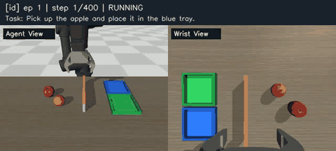
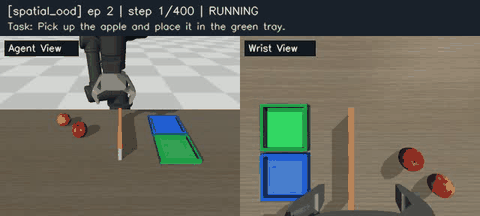
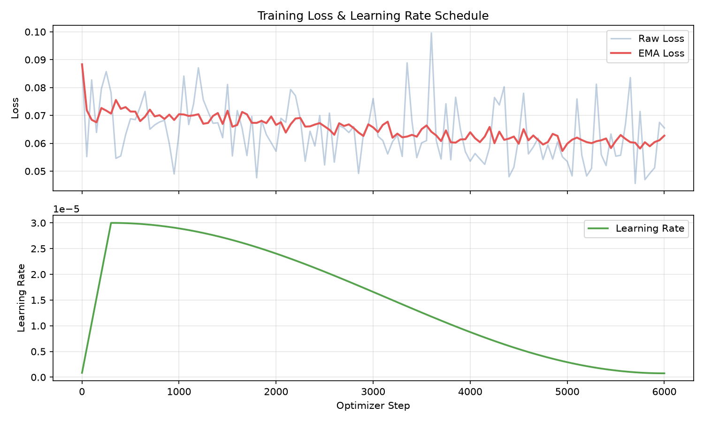
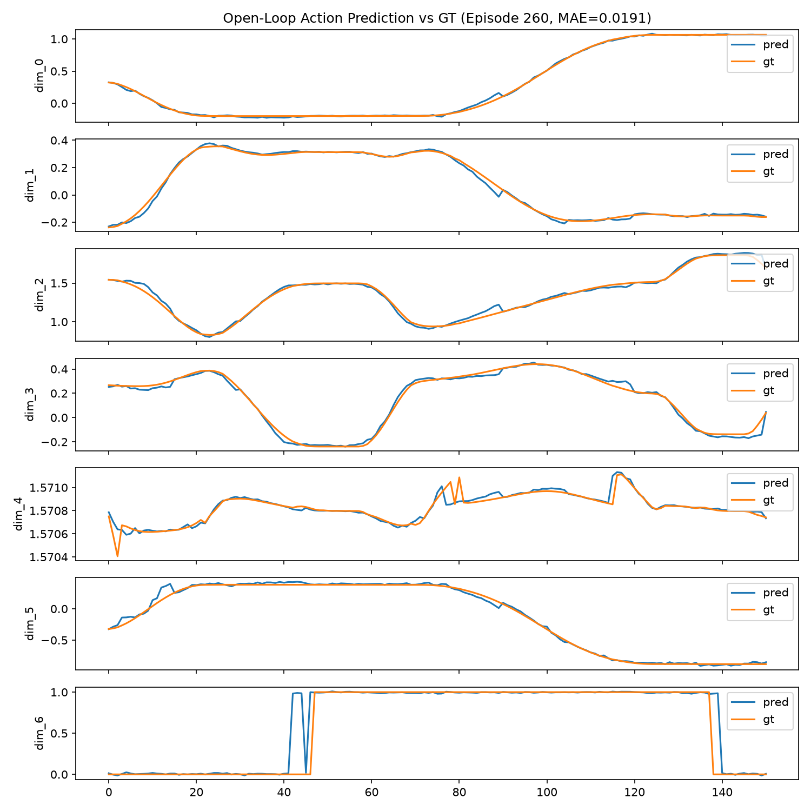

# 语言条件 3D 跨障分拣机器人项目（MuJoCo + SmolVLA）

基于 **MuJoCo** 与 **LeRobot v3.0** 搭建的**语言条件跨障桌面分拣仿真与 SmolVLA 微调评测项目**（精简主线版）。

桌面左侧随机放置苹果与橙子（可额外加入红牛罐干扰物），中间设有 **5.5 cm 半透明隔板**防止平推作弊，右侧为蓝/绿双色分拣托盘。项目完整打通了：**多任务环境搭建 → 手柄遥操作采数（264 条）→ 两阶段 SmolVLA 微调 → 四维 OOD 闭环评测与 8 类失败归因 → 推理去噪加速消融**。

---

## 核心亮点

1. **真实物理难度的多任务跨障环境（[y_env.py](mujoco_env/y_env.py)、[sorting_objects.xml](asset/sorting_objects.xml)）**
   - 基于 `ROBOTIS OpenManipulator-Y` 6 轴机械臂构建 4 条语言条件分拣任务（苹果/橙子 × 蓝/绿托盘），中间 5.5 cm 隔板强制机械臂学习“抓取 → 抬升越障 → 精准放盘”的 3D 空间弧线。
   - 使用 1:1 平行夹爪联动防挤飞设计、5 条件严格成功判定（盘内位置、无误放、物体静止、夹爪释放、末端抬离安全高度）与高频隔板碰撞检测。
2. **规范的数据采集与防泄露验证（[collectData.py](scripts/collectData.py)、[train_utils.py](scripts/train_utils.py)）**
   - 手柄遥操作防脏数据三招：**推摇杆才触发开录**（去开头静止帧）、**按住 B 键 0.4× 慢速精细对准**、**失误按 Y 键清空缓存重录**。
   - 按 20Hz 采集 200 条常规轨迹 + 64 条红牛罐干扰/边界轨迹，共 **264 条**四任务 1:1:1:1 均衡数据；验证集严格按整条 Episode 切分，避免相邻帧数据泄露。
3. **问题驱动的三轮迭代调优（5% → 30% → 45%，红牛罐抗干扰翻 8 倍）**
   - 构建 `id`、`visual_ood`（红牛罐干扰）、`spatial_ood`（边界外推）、`lang_ood`（同义改写指令）四维同种子闭环基准与 8 类失败归因，精确定位瓶颈并完成三轮调优。
4. **Flow Matching 推理加速消融（提速 2.5 倍，181.5 FPS）**
   - 通过重规划周期消融（`n_action_steps=15`）与去噪步数消融（`10 → 3` 步），单步平均推理延迟从 `13.74 ms` 降至 **`5.51 ms`（181.5 FPS）**，标准场景成功率进一步升至 **`50.0%`**，隔板碰撞降至 **`5.0%`**。

---

## 闭环演示效果（Agent View + Wrist View）

> 以下 GIF 均在相同随机种子 `seed=100` 下由 `SmolVLA v3` 无界面闭环运行导出：

| `ID` 标准场景 (`172 steps`) | `Visual OOD` 红牛罐干扰 (`167 steps`) | `Spatial OOD` 边界位置外推 (`158 steps`) |
| :---: | :---: | :---: |
|  |  |  |

---

## 实验迭代与消融结果

### 1. SmolVLA 三轮调优与推理加速演进（每套件 20 回合，固定种子 `100~119`）

| 迭代版本 | 核心改动 | `ID` 成功率 | `Visual OOD` (红牛罐) | `Spatial OOD` | 隔板碰撞率 | Avg ms (FPS) | 关键现象与问题定位 |
| :--- | :--- | ---: | ---: | ---: | ---: | ---: | :--- |
| **SmolVLA v1** | `chunk=5`，仅训动作专家 | 5.0% (1/20) | 10.0% (2/20) | 15.0% (3/20) | 36.2% | 46.29 ms (21.6) | 离线误差很低但闭环短视（0.25s），频繁犹豫超时与撞隔板 |
| **SmolVLA v2** | `chunk=30, n=15` + 补 64 条 OOD 数据 + 图像增强 | 30.0% (6/20) | 5.0% (1/20) | **20.0% (4/20)** | **13.8%** | 15.62 ms (64.0) | 越障轨迹变连贯；但腕部加了强遮挡/变色增强，导致近距抓滑掉落 |
| **SmolVLA v3** | 关掉腕部增强 + 二阶段解冻 VLM 联合精调 | **45.0% (9/20)** | **40.0% (8/20)** | **20.0% (4/20)** | 18.8% | **13.50 ms (74.1)** | 抓准与水果/红牛罐区分大幅提升（`distractor_hijack=0`）；仅 4 句固定模板微调 VLM 引发同义句遗忘 |
| **SmolVLA v3 (3步去噪)** | Flow Matching 去噪步数 `10 -> 3` | **50.0% (10/20)** | — | — | **5.0%** | **5.51 ms (181.5)** | 推理提速 **2.49×**，闭环控制更跟手 |

### 2. 失败归因演化（全量 80 回合统计）

| 模型版本 | 失败总数 | `wrong_object` | `distractor_hijack` | `wrong_tray` | `release_or_retreat_fail` | `barrier_drop` | `transit_drop` | `grasp_fail` | `reach_timeout` |
| :--- | ---: | ---: | ---: | ---: | ---: | ---: | ---: | ---: | ---: |
| `SmolVLA v1` | 72 | 19 | 1 | 1 | 0 | 13 | 3 | 8 | 27 |
| `SmolVLA v2` | 69 | 13 | **0** | 2 | 0 | **4** | 12 | 16 | 22 |
| `SmolVLA v3` | **59** | **11** | **0** | 2 | 0 | 9 | 15 | 15 | **7** |

### 3. 消融实验

- **重规划周期消融（`SmolVLA v2`, `ID` 20 回合）**：`n_action_steps=15`（每 0.75s 重规划）成功率 **35.0%**、隔板碰撞 **5.0%**；`n=8` 降为 **20.0%**（碰撞 **40.0%**），说明 Flow Matching 每次重推理重新采样噪声，过频重规划会引发越障半途轨迹切换抖动。
- **去噪步数消融（`SmolVLA v3`, `ID` 20 回合）**：`10 步 -> 5 步 -> 3 步 -> 1 步`，`3 步` 达到速度与精度最佳平衡（**50.0%** 成功率、`5.51 ms`、`181.5 FPS`、`5.0%` 碰撞率）。

### 4. 训练收敛与验证集开环评估曲线

| `SmolVLA v2` 训练收敛 (`loss -> 0.0671`) | `SmolVLA v3` 协同精调收敛 | `SmolVLA v3` 验证集开环 MAE (`ep260: 0.0191`) |
| :---: | :---: | :---: |
|  |  |  |

---

## 核心代码导读（极简精读版）

项目由 **6 个简洁脚本（共约 750 行）** 驱动，底层 `mujoco_env/` 与 `asset/` 为开源仿真底座：

| 文件 | 职责 | 你需要关注的核心内容 |
| :--- | :--- | :--- |
| [scripts/collectData.py](scripts/collectData.py) | 手柄/键盘遥操作采数 | 数据集字段定义、推摇杆开录 / B 键 0.4× 慢速 / Y 键清空重录 |
| [scripts/visualizeData.py](scripts/visualizeData.py) | 数据集 GUI 回放 | 恢复物体初位与指令并重演动作，用于抽检演示质量 |
| [scripts/train_utils.py](scripts/train_utils.py) | 训练通用工具 | `split_train_val_episodes` 防泄露切分、`VisualAugmentor`（兼容 4D/5D 张量）、MAE 评估 |
| [scripts/train_smolvla.py](scripts/train_smolvla.py) | **SmolVLA 微调主线** | 5 段式标准训练模板：加载权重 → 冻层开关 → 标准 6 行 PyTorch 训练循环 → 评估 |
| [scripts/eval_benchmark.py](scripts/eval_benchmark.py) | 四维闭环评测与归因 | `SUITES` 定义、`classify_failure` 8 类归因、`--num-denoising-steps` 消融 |
| [scripts/deploy.py](scripts/deploy.py) | 交互式开窗演示 | 加载微调后权重并传入自定义英文指令跑闭环演示 |
| `mujoco_env/y_env.py` | 仿真环境（底座） | `TASKS` 4 条指令、手柄映射、5 条件 `check_success()` 与碰撞检测 |

---

## 快速运行命令

```bash
# 1. 安装依赖与烟雾测试
pip install -r requirements.txt
pip install --no-deps -e .
python -m unittest discover -s tests -v

# 2. 手柄遥操作采数与 GUI 回放检查
python -m scripts.collectData --num-episodes 20 --task-mode cycle
python -m scripts.visualizeData --dataset-root ./dataset/smolvla_dataset --episode 0 --once

# 3. 两阶段 SmolVLA 微调
# Stage-1: 冻结视觉与 VLM 主干，仅微调动作专家（主视角开启增强，腕部保持洁净）
python -m scripts.train_smolvla \
  --pretrained-path lerobot/smolvla_base --dataset-root ./dataset/smolvla_dataset \
  --output-dir ./ckpt/smolvla_v2 --chunk-size 30 --n-action-steps 15 --steps 10000 --image-aug

# Stage-2: 解冻 VLM 主干协同精调
python -m scripts.train_smolvla \
  --pretrained-path ./ckpt/smolvla_v2 --dataset-root ./dataset/smolvla_dataset \
  --output-dir ./ckpt/smolvla_v3 --chunk-size 30 --n-action-steps 15 --steps 6000 \
  --lr 3e-5 --warmup-steps 300 --no-train-expert-only

# 4. 四维闭环基准评测（3 步去噪加速）与交互式部署
python -m scripts.eval_benchmark --ckpt-path ./ckpt/smolvla_v3 --suites all --num-denoising-steps 3 --output-dir ./eval_results/smolvla_v3
python -m scripts.deploy --ckpt-path ./ckpt/smolvla_v3 --ood-distractor --instruction "Pick up the apple and place it in the blue tray."
```

---

## Acknowledgements

- 仿真结构改编自 [lerobot-mujoco-tutorial](https://github.com/jeongeun980906/lerobot-mujoco-tutorial)
- 策略与数据集框架基于 HuggingFace [LeRobot](https://github.com/huggingface/lerobot)
- 机械臂模型来自 [robotis_mujoco_menagerie](https://github.com/ROBOTIS-GIT/robotis_mujoco_menagerie)，物体网格来自 [YCB Object Set](https://www.ycbbenchmarks.com/)
